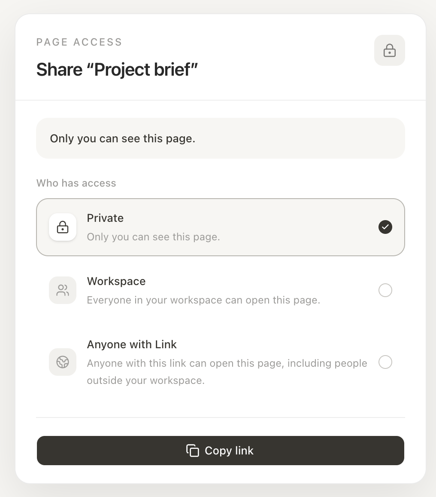
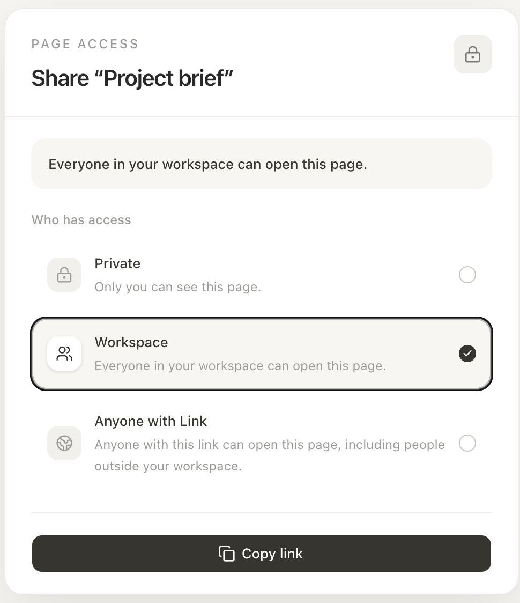
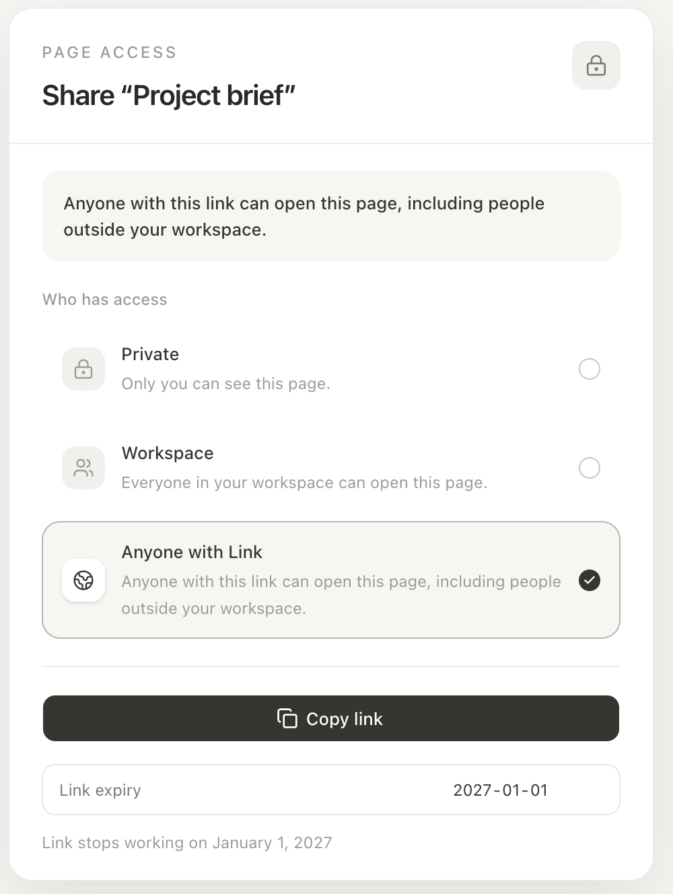

# Prompt Session Log, Share Panel (v0 pass)

Notes I kept while generating a throwaway share-panel prototype in v0 from the README, so the next person doesn't burn iterations on a vague first prompt.

## What I needed

Monday 26 October 2026, Lauren Chen is reviewing the Notion share panel build spec and I had nothing clickable to point at, only the README. Throwaway quality was fine: it needs to open in a browser, show all three lock states, and let the reviewer click between them, copy the link and pick an expiry, then it gets thrown away.

## Prompt 1, the paste-in

I pasted the README in as written rather than describing it, with one line added at the top saying I want one share panel screen only. The three state sentences are quoted exactly and the copy link and expiry behaviour is spelled out per state. When I leave the wording open, v0 invents its own copy and then every follow-up is a rewrite. I left out the empty headings at the bottom (prototype links, defect table, scorecard, recommendation) since they aren't part of the build.

```
I want one share panel screen only.

# notion-share-panel-redesign

Redesigning the share panel on notion so it is easy to see whether a page is private, open to the workspace, or only accessible with a link

## What this surface is

Tells you who can access a page

## Lock states

| State | What it means |
| --- | --- |
| Private | "Only you can see this page." |
| Workspace | "Everyone in your workspace can open this page." |
| Anyone with Link | "Anyone with this link can open this page, including people outside your workspace." |

## Primary button behaviour

Copy link button, on click:
the page URL is placed on the clipboard, and the button label changes to "Copied" for 2 seconds, then back to "Copy link"

Copy link, by state:

| State | Who the copied link opens for |
| --- | --- |
| Private | Only you. Anyone else sees "You don't have access to this page" |
| Workspace | Everyone in your workspace. Anyone outside it sees "You don't have access to this page" |
| Anyone with Link | Anyone who has the link |

Expiry, when the user picks an expiry (Anyone with Link only):
the panel shows a line under the copy button reading "Link stops working on date", using the date chosen
Expiry, once the date has passed:
the link no longer opens the page and shows "This link has expired", the line under the copy button reads "Link stopped working on date", and the page goes back to Private

## Acceptance checks
1. The share panel shows three state rows: Private, Workspace and Anyone with Link        Y/N
2. Picking each state in turn changes the status sentence to that state's row             Y/N
3. Clicking Copy link puts the page URL on the clipboard (paste it into a new tab)        Y/N
4. After clicking Copy link, the button reads "Copied" for 2 seconds, then "Copy link"    Y/N
5. Picking an expiry date shows "Link stops working on date" under the copy button        Y/N
```

## Follow-ups

1. "why doesn't the dropdown next to the copy link click?"
   *Changes:* initialized on-click handler

2. "The drop-down works, but anything that should be visible in the drop-down is not visible. It's covered by the edge, so you need to fix that."
   *Changes:* removed overflow-hidden

3. "Now, when you do the drop-down during the anyone with link, the link expiry and that drop-down kind of coincide. It's not very UI-friendly. Find a way to make it UI-friendly."
   *Changes:* dropdown opens without blocking content

4. "You know what? Get rid of the drop-down. We don't need it. Get rid of it."
   *Changes:* decided dropdown was not important, deleted it.

## Getting it in front of Lauren

The preview pane in the v0 chat is not a link anyone else can open, and neither is the chat or editor URL. I used the **Publish** button, which deploys the project and gives back its own `.vercel.app` address: https://notion-share-panel-redesign.vercel.app/. Before sending it I opened that address in a private browsing window, signed out of everything, and it loaded with no login. I clicked through all three states and took one screenshot of each. I also ran the five acceptance checks from the README against the published address and all five pass.

## Screenshots

Taken in a private window while signed out.

   
   
   
